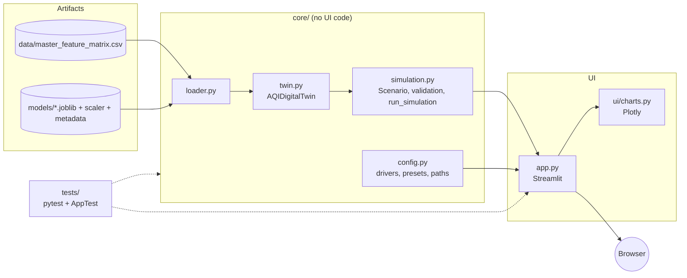

# Digital Twin for Air Quality Index (AQI)

[](https://github.com/rajkumardotnet90/Digital-twin/actions/workflows/ci.yml)

An interactive Streamlit app that wraps the AQI Digital Twin built for the IITJ project. Pick zones, a prediction
model and policy levers (traffic, renewables, EV adoption, sensor readings), then watch the predicted AQI and the
multi-month forecast change live, compare runs side by side, and export the results as CSV.

The original pipeline (data preparation → EDA → feature engineering → modelling → deployment notebook) produced the
trained models. This repository extracts the twin from the notebook into an importable, tested package and adds the UI.

## Screenshots

> Placeholders - run the app, take screenshots and save them under `docs/screenshots/`, then replace these lines
> with `` etc.

| Forecast tab | Zones tab | Compare runs |
|---|---|---|
| _docs/screenshots/forecast.png_ | _docs/screenshots/zones.png_ | _docs/screenshots/compare.png_ |

## Features

- **Live what-if simulation** - sliders for six policy drivers plus seven sensor overrides (% change).
- **Policy presets** from the notebook: Green Transport, Clean Energy, EV Push, Combined Green Policy.
- **Model selector** - 10 trained models; a warning appears when the chosen model ignores your changes.
- **Interactive Plotly charts** - observed history, no-change forecast and scenario forecast with AQI category bands.
- **Compare runs** - pin a baseline, save runs with *Run Simulation*, and overlay them with a metrics table.
- **Results table + CSV download** for the forecast and the per-zone summary.
- **Input validation** with friendly errors (no zones selected, out-of-range values, unknown base month ...).
- **Run Simulation / Reset to Defaults / Live update toggle**.

## Architecture



```text
digital-twin-app/
├── app.py                # Streamlit UI (widgets and layout only)
├── core/                 # model + simulation logic (testable, UI-free)
│   ├── config.py         # paths, drivers, presets, model registry (env-configurable)
│   ├── twin.py           # AQIDigitalTwin (ported from the notebook)
│   ├── simulation.py     # Scenario, validation, run_simulation
│   ├── loader.py         # artifact loading
│   └── aqi.py            # AQI categories / colours
├── ui/charts.py          # Plotly figure builders
├── data/                 # master_feature_matrix.csv (660 rows: 10 zones x 66 months)
├── models/               # trained models, scaler, metadata
├── tests/                # unit, parity (vs notebook outputs) and UI smoke tests
├── .streamlit/config.toml, Dockerfile, render.yaml, .github/workflows/ci.yml
└── README.md, DEPLOYMENT.md, DEMO_SCRIPT.md
```

## Run locally

Requires Python 3.11+.

```bash
git clone https://github.com/rajkumardotnet90/Digital-twin.git
cd Digital-twin
python3 -m venv .venv && source .venv/bin/activate
pip install -r requirements-dev.txt      # use requirements.txt for runtime only
cp .env.example .env                     # optional
streamlit run app.py                     # opens http://localhost:8501
```

Run the checks:

```bash
ruff check . && ruff format --check .
pytest -q
```

Run with Docker:

```bash
docker build -t digital-twin-aqi .
docker run --rm -p 8501:8501 --env-file .env digital-twin-aqi
```

## Deploy

Step-by-step guides for **Streamlit Community Cloud** (free), **Render** and **Hugging Face Spaces** are in
[DEPLOYMENT.md](DEPLOYMENT.md). A 5-minute presentation walkthrough is in [DEMO_SCRIPT.md](DEMO_SCRIPT.md).

## Parameters

**Scope**

| Control | Default | Range | Meaning |
|---|---|---|---|
| Zones | all 10 | any subset | Zones simulated; charts average across them |
| Prediction model | ElasticNet | 10 models | Lasso has the best test R² but ignores most drivers; ElasticNet is the notebook's what-if model |
| Forecast horizon | 42 months (through Dec 2027) | 1-42 | Months forecast after the base month |
| Base month | Jun 2024 | any observed month | Starting state of the simulation |

**Scenario drivers (% change applied to the zone's base-month value)**

| Driver | Feature | Range |
|---|---|---|
| Traffic volume | `avg_traffic_volume` | -100 to +100 % |
| Renewable energy share | `avg_renewable_pct` | -100 to +200 % |
| Energy consumption | `avg_energy_consumption` | -100 to +100 % |
| EVs charged | `total_vehicles_charged` | -100 to +300 % |
| EV energy dispensed | `total_energy_dispensed` | -100 to +300 % |
| Noise level | `avg_noise_db` | -50 to +50 % |
| Sensor overrides: PM2.5, PM10, NO2, SO2, O3, CO, CO2 | `pm2_5`, `pm10`, `no2`, `so2`, `o3`, `co`, `co2` | -50 to +100 % |

**Environment variables** (all optional, see `.env.example`): `DT_DATA_DIR`, `DT_MODEL_DIR`, `DT_DEFAULT_MODEL`,
`DT_DEFAULT_HORIZON`, `DT_MAX_HORIZON`, `DT_MAX_SAVED_RUNS`.

## How it works and limitations

For each zone the app takes the state at the base month, scales the chosen drivers, and predicts AQI with and without
the change; the forecast then rolls forward month by month. Behaviour is identical to the deployment notebook and is
verified by parity tests against its saved outputs. Please keep in mind:

- Forecasts hold every feature constant except month, year, quarter and the sin/cos month terms (as in the notebook).
  Consequently the 2025-2027 forecasts are almost flat: they extend the latest observed state, they do not predict
  future trends or seasons.
- Changing a driver does not recompute derived features (lags, rolling statistics, interaction terms).
- AQI is computed from pollutants that are also model inputs, so the very high test R² (~0.9999 for Lasso) partly
  reflects that relationship. Results are correlational, not causal.
- Tree-based models cannot extrapolate and may jump unrealistically; prefer linear models for what-if analysis.
- Models are loaded with `joblib` (pickle). Only load model files you trust.

## Testing

`pytest` runs 29 tests: notebook-parity checks, scenario and validation logic, chart builders, and headless UI tests
(Streamlit `AppTest`) covering presets, Run, Reset, live-update off, validation errors and model switching.
